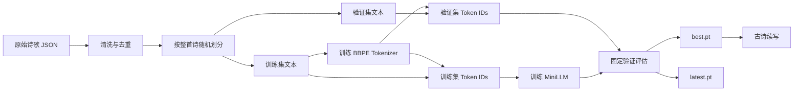

# Poetry MiniLLM

Poetry MiniLLM 是一个从数据清洗、分词器训练、Transformer 建模到文本生成的完整古诗语言模型项目。项目使用全唐诗语料训练一个约 2822 万参数的自回归模型：输入一段诗句开头，模型逐 token 预测后续内容，直到生成结束标记或达到长度上限。

项目的重点是把语言模型训练的核心环节完整串联起来，并通过固定验证集、最佳模型保存和提前停止控制过拟合。

## 项目特点

- 从原始 JSON 中提取诗歌正文，去除校勘括注、缺字标记和异常字符。
- 以“整首诗”为单位划分训练集和验证集，避免在诗句中间切断数据。
- 只使用训练集训练 Byte-level BPE 分词器，防止验证集信息泄漏。
- 使用 RMSNorm、RoPE、GQA 和 SwiGLU 构建 Decoder-only Transformer。
- 使用适合 Transformer 的权重初始化，使初始 loss 接近 `ln(词表大小)`。
- 使用固定验证样本评估，保证不同训练步数的指标可以直接比较。
- 自动维护最佳模型和最新模型，并在验证指标持续无改善时提前停止。
- 支持训练中断恢复、Top-k/Top-p 采样和重复惩罚。

## 整体流程



对应的执行顺序为：

1. `prepare_data.py`：读取、清洗、去重并划分语料。
2. `train_tokenizer.py`：使用训练语料训练分词器。
3. `pack_data.py`：把训练集和验证集分别编码为 NumPy token 数组。
4. `train.py`：训练模型、记录指标、保存 checkpoint 并执行提前停止。
5. `generate.py`：加载最佳模型，根据提示词生成诗句。

## 目录结构

```text
poetry-llm/
├─ chinese-poetry/          # 原始诗歌数据仓库
├─ data/
│  └─ tang/
│  │  ├─ corpus_train.txt   # 清洗后的训练诗歌，一行一首
│  │  ├─ corpus_val.txt     # 清洗后的验证诗歌，一行一首
│  │  ├─ corpus.txt         # 训练集与验证集汇总，便于检查
│  │  ├─ train_ids.npy      # 训练 token 序列
│  │  └─ val_ids.npy        # 验证 token 序列
├─ checkpoints/             # 正式训练结果
│  ├─ best.pt               # 验证 loss 最低的模型
│  ├─ latest.pt             # 训练停止时的最新状态
│  └─ metrics.csv           # 训练和验证指标
├─ prepare_data.py          # 数据清洗与划分
├─ train_tokenizer.py       # BBPE 分词器训练
├─ pack_data.py             # 文本 token 化与二进制打包
├─ RMSNorm.py               # RMSNorm 实现
├─ RoPE.py                  # 旋转位置编码实现
├─ SwiGLU.py                # SwiGLU 前馈网络实现
├─ model.py                 # Transformer 与 MiniLLM 定义
├─ train.py                 # 模型训练入口
├─ generate.py              # 文本生成入口
├─ tokenizer.json           # 全唐诗 BBPE 分词器
└─ requirements.txt         # Python 依赖
```

当前流程统一使用 `data/tang/`、`tokenizer.json` 和 `checkpoints/`。重新训练前清空 `checkpoints/`，可以确保其中只包含同一轮实验产生的结果。

## 环境要求

建议使用 Python 3.10 或更高版本。主要依赖如下：

- PyTorch
- NumPy
- Hugging Face Tokenizers

安装依赖：

```powershell
python -m pip install -r requirements.txt
```

训练约 2822 万参数的模型时建议使用支持 CUDA 的显卡。程序会自动检测 CUDA；没有可用显卡时会使用 CPU，但训练速度会明显降低。

可以通过下面的命令检查 PyTorch 是否识别到显卡：

```powershell
python -c "import torch; print(torch.cuda.is_available(), torch.cuda.get_device_name(0) if torch.cuda.is_available() else 'CPU')"
```

## 数据处理思路

### 1. 数据来源与正文提取

默认从以下目录递归读取 JSON：

```text
chinese-poetry/全唐诗/poet.tang.*.json
```

每条记录使用 `paragraphs` 字段作为正文，并将同一首诗的多个段落连接成一条样本。标题、作者、生平和注释字段不参与训练，减少非诗歌文本对模型的干扰。

### 2. 清洗规则

`prepare_data.py` 会执行以下处理：

- 进行 Unicode NFKC 规范化；
- 统一中英文逗号、句号、问号、感叹号、分号和冒号；
- 删除圆括号中的校勘说明；
- 删除空格和换行；
- 拒绝含 `□`、`■`、替换字符等缺字标记的样本；
- 拒绝包含拉丁字母、数字和编辑标记的样本；
- 只保留长度在 10 到 200 字符之间的文本；
- 对完全相同的正文去重。

当前清洗结果：

| 数据项 | 数量 |
|---|---:|
| 匹配的数据文件 | 58 个 |
| 原始记录 | 57,607 首 |
| 清洗后保留 | 53,492 首 |
| 过滤或去重 | 4,115 首 |
| 训练集 | 48,143 首 |
| 验证集 | 5,349 首 |
| 训练 token | 2,303,699 |
| 验证 token | 254,554 |

### 3. 数据划分

程序使用固定随机种子 `42` 打乱诗歌，随后按 90%/10% 划分训练集和验证集。划分发生在 token 化之前，并以整首诗为单位，因此同一首诗不会同时出现在两边，也不会在诗句中间切开。

## 分词器

项目使用 Byte-level BPE，词表大小为 8000，并添加 `<|endoftext|>` 作为每首诗的结束标记。

选择 Byte-level BPE 的原因：

- 任意 Unicode 文本都可以编码，不依赖未知词标记；
- 高频汉字和常见词组可以合并为更紧凑的 token；
- 词表规模适中，兼顾模型输出层大小和文本压缩率；
- 每首诗末尾的结束标记让模型学习何时停止生成。

分词器只使用 `corpus_train.txt` 训练，验证文本不会参与词表学习。

## 模型结构

模型采用仅包含解码器的自回归 Transformer。给定 token 序列 `x₁, x₂, ..., xₙ`，训练目标是预测每个位置的下一个 token。

| 配置 | 数值 |
|---|---:|
| 词表大小 | 8000 |
| 隐藏维度 | 512 |
| Transformer 层数 | 8 |
| Query 头数 | 8 |
| Key/Value 头数 | 2 |
| FFN 隐藏维度 | 1536 |
| 最大上下文长度 | 256 |
| 训练序列长度 | 128 |
| 参数量 | 约 28.22M |

每个 Transformer Block 包含：

1. RMSNorm；
2. 带 RoPE 的分组查询注意力 GQA；
3. 残差连接；
4. RMSNorm；
5. SwiGLU 前馈网络；
6. 残差连接。

输入 Embedding 与输出语言模型头共享权重，减少参数量并让输入和输出 token 使用同一表示空间。

线性层和 Embedding 使用标准差为 `0.02` 的正态分布初始化，注意力输出层和 FFN 下投影层根据层数进一步缩放。修正后的初始 loss 为 `9.1456`，接近随机预测的理论值 `ln(8000) = 8.9872`。

## 训练策略

默认训练配置：

| 参数 | 默认值 |
|---|---:|
| Batch size | 32 |
| Block size | 128 |
| 最大训练步数 | 8000 |
| 初始学习率 | 3e-4 |
| Warmup | 400 步 |
| Decay | 1600 步 |
| 评估间隔 | 250 步 |
| 每次评估 batch 数 | 40 |
| 提前停止 patience | 5 次评估 |
| 最小显著改善量 | 0.005 |
| 梯度裁剪 | 1.0 |

优化器使用 AdamW，参数为 `betas=(0.9, 0.95)`、`weight_decay=0.1`。学习率采用 Warmup-Stable-Decay 调度：训练初期线性升高，随后保持稳定，末期逐步衰减。

训练损失使用下一个 token 的交叉熵：输入是长度 128 的 token 窗口，目标是同一窗口向右移动一位后的序列。

### 固定验证评估

训练开始时根据固定随机种子生成训练评估位置和验证评估位置，此后每次评估都使用相同窗口。这样可以减少随机抽样波动，使不同 step 的 loss 更容易比较。

### 最佳模型与提前停止

- `best.pt`：只要验证 loss 创造新的最低值，就立即更新。
- `latest.pt`：保存最近一次训练状态，用于意外中断后恢复。
- `metrics.csv`：记录 step、训练 loss、验证 loss、验证困惑度和学习率。
- `min-delta` 只用于判断一次改善是否足以重置提前停止计数，不会阻止更低 loss 的模型保存为 `best.pt`。
- 连续 5 次验证没有显著改善时自动停止，防止模型继续记忆训练集。

checkpoint 还保存优化器、学习率调度器、Python/NumPy/PyTorch/CUDA 随机状态和训练 batch 生成器状态，便于较准确地恢复训练。

### 为什么使用“最多 8000 步 + 提前停止”

当前全唐诗训练集包含 2,303,699 个 token。按默认的 `batch_size=32`、`block_size=128` 计算，每一步处理 4096 个 token，一次近似遍历需要约 562 步。8000 步相当于约 14.2 次遍历，20000 步则相当于约 35.6 次遍历。这里的“遍历”是按 token 数估算，因为训练窗口采用有放回的随机抽样。

对于约 2822 万参数、约 230 万训练 token 的组合，固定执行 20000 步很容易让模型继续记忆训练数据。训练 loss 仍会下降，但验证 loss 和实际生成质量可能变差。因此 8000 只是安全上限，真正停止位置由验证集决定。如果模型在 8000 步时验证 loss 仍持续下降，再把上限提高到 12000 或 20000；不应预先要求每次都完整执行 20000 步。

## 快速开始

进入项目目录：

```powershell
cd "D:\Extra Learning\山羊AI算法\Assignments\poetry-llm"
```

仓库不直接提交原始语料、处理后数据和 checkpoint。首次运行时先下载数据仓库：

```powershell
git clone --depth 1 https://github.com/chinese-poetry/chinese-poetry.git
```

### 完整重建数据并训练

第一次运行或需要重新清洗语料时，依次执行：

```powershell
python prepare_data.py
python train_tokenizer.py
python pack_data.py
python train.py
```

前三步分别生成 `data/tang/`、`tokenizer.json` 和 token 数组。最后一步将模型写入 `checkpoints/`。

### 使用已经准备好的数据重新训练

本地已经执行过前三个数据准备步骤时，可以直接训练：

```powershell
python train.py --total-steps 8000 --warmup-steps 400 --decay-steps 1600 --batch-size 32 --eval-every 250 --eval-batches 40 --patience 5
```

如果需要同时进行另一组实验，请换一个 checkpoint 目录，例如：

```powershell
python train.py --checkpoint-dir checkpoints_exp2
```

### 恢复中断的训练

恢复指定目录中的 `latest.pt`：

```powershell
python train.py --resume
```

也可以显式指定 checkpoint：

```powershell
python train.py --resume checkpoints/latest.pt
```

`--resume` 只能用于继续当前数据、tokenizer 和模型配置产生的 checkpoint。

### 显存不足

首先把 batch size 改为 16：

```powershell
python train.py --batch-size 16
```

如果仍然显存不足，可以继续降低到 8。更改 batch size 会改变每一步看到的 token 数，因此新的训练曲线不能与 batch size 32 的曲线完全等价。

## 文本生成

完成训练后，默认加载 `checkpoints/best.pt` 和 `tokenizer.json`：

```powershell
python generate.py --prompt "床前明月光，"
```

可以一次测试多个开头：

```powershell
python generate.py --prompt "春江" --prompt "白日依山" --prompt "故人西辭"
```

常用生成参数：

| 参数 | 作用 | 默认值 |
|---|---|---:|
| `--max-new-tokens` | 最多新增多少 token | 80 |
| `--temperature` | 越低越保守，越高越随机 | 0.85 |
| `--top-k` | 只从概率最高的 K 个 token 中采样 | 50 |
| `--top-p` | 从累计概率范围内采样 | 0.9 |
| `--repetition-penalty` | 降低重复 token 的概率 | 1.1 |
| `--seed` | 控制采样随机性 | 42 |

降低随机性的示例：

```powershell
python generate.py --prompt "床前明月光，" --temperature 0.7 --top-k 30 --top-p 0.85
```

完全使用贪心解码：

```powershell
python generate.py --prompt "床前明月光，" --temperature 0
```

## 最终实验结果

正式训练使用 `data/tang/`、`tokenizer.json` 和默认训练参数。模型在 step 2499 取得最低验证 loss，随后验证指标连续 5 次没有显著改善，于 step 3749 自动停止。

| 阶段 | Step | 训练 loss | 验证 loss | 验证困惑度 |
|---|---:|---:|---:|---:|
| 初始化 | 0 | 9.0722 | 9.0730 | 8716.67 |
| 最佳模型 | 2499 | 4.3568 | 5.0323 | 153.28 |
| 提前停止 | 3749 | 3.5676 | 5.1607 | 174.28 |

从 step 2499 到 step 3749，训练 loss 继续从 4.3568 降至 3.5676，但验证 loss 从 5.0323 上升至 5.1607，表明模型已经开始过拟合。提前停止机制因此保留 step 2499 的参数作为正式模型：

```text
checkpoints/best.pt
```

`checkpoints/latest.pt` 保存 step 3749 的训练状态，主要用于恢复训练，不用于最终生成。完整曲线数据保存在 `checkpoints/metrics.csv`。

### 生成结果

使用默认随机种子和默认生成参数执行：

```powershell
python generate.py
```

得到：

```text
开头「春」→ 春早。

开头「白日」→ 白日來，萬里秋風至。

开头「床前明月光，」→ 床前明月光，小檻晴川雲影涼。
```

三个结果均能正常结束，并表现出古诗常用词汇、传统汉字、句末标点和较明确的诗句节奏。其中“白日來，萬里秋風至”形成了相对完整的上下分句；“床前明月光，小檻晴川雲影涼”在意象和句式上具有一定连贯性。单字提示“春”的生成仍较短，说明模型在提示信息不足时容易较早预测结束标记。

当前模型学习的是通用自回归续写，没有显式加入五言、七言、押韵和平仄约束。评估生成结果时应同时观察语言通顺度、意象连贯性、重复情况和格式完整性，不能只比较训练 loss。

## 参数与脚本帮助

查看各脚本支持的完整参数：

```powershell
python prepare_data.py --help
python train_tokenizer.py --help
python pack_data.py --help
python train.py --help
python generate.py --help
```

## 常见问题

### 生成结果很短

单字提示包含的信息较少，模型也可能很快预测结束标记。可以使用更完整的半句作为提示，并适当提高温度或生成多个随机种子：

```powershell
python generate.py --prompt "春江潮水連海平，" --seed 7
```

### 生成内容重复

可以提高重复惩罚并略微降低温度：

```powershell
python generate.py --prompt "明月照高樓，" --temperature 0.75 --repetition-penalty 1.2
```

### 训练 loss 下降但验证 loss 上升

这是过拟合信号。应使用 `best.pt` 生成，不要使用 `latest.pt`。程序已经通过固定验证评估和提前停止自动处理这一情况。

### 为什么 checkpoint 文件较大

checkpoint 同时保存模型参数、AdamW 优化器状态、学习率调度器和随机状态，因此文件大小明显大于纯模型参数。生成时只读取其中的模型配置和权重。

### 为什么旧 checkpoint 不能继续训练

当前版本修改了权重初始化、数据清洗、训练/验证划分和分词器。旧 checkpoint 已经绑定旧数据分布和旧 tokenizer，继续训练会使实验条件混合。

## 后续改进方向

- 增加更多经过清洗的唐诗、宋诗或宋词语料，并为不同体裁添加控制 token。
- 为五言绝句、七言绝句等格式建立单独数据集或添加长度标签。
- 在生成阶段加入行数、每句字数、押韵和平仄约束。
- 添加模型生成样例的定期记录，观察不同 step 的实际文本质量。
- 对验证集执行完整滑窗评估，获得比固定抽样更精确的最终指标。
- 尝试 dropout、减小模型规模或增加数据量，进一步缩小训练/验证差距。
- 将纯推理权重单独导出，减小模型发布体积。

## 复现说明

默认随机种子为 42。数据划分、训练 batch 抽样、固定评估窗口和生成采样都可以通过种子复现。不同 GPU、CUDA、PyTorch 版本和底层算子仍可能产生细小数值差异，因此最终 loss 和生成文本可能不会逐字完全一致。
